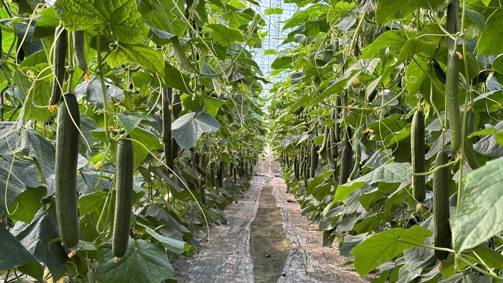
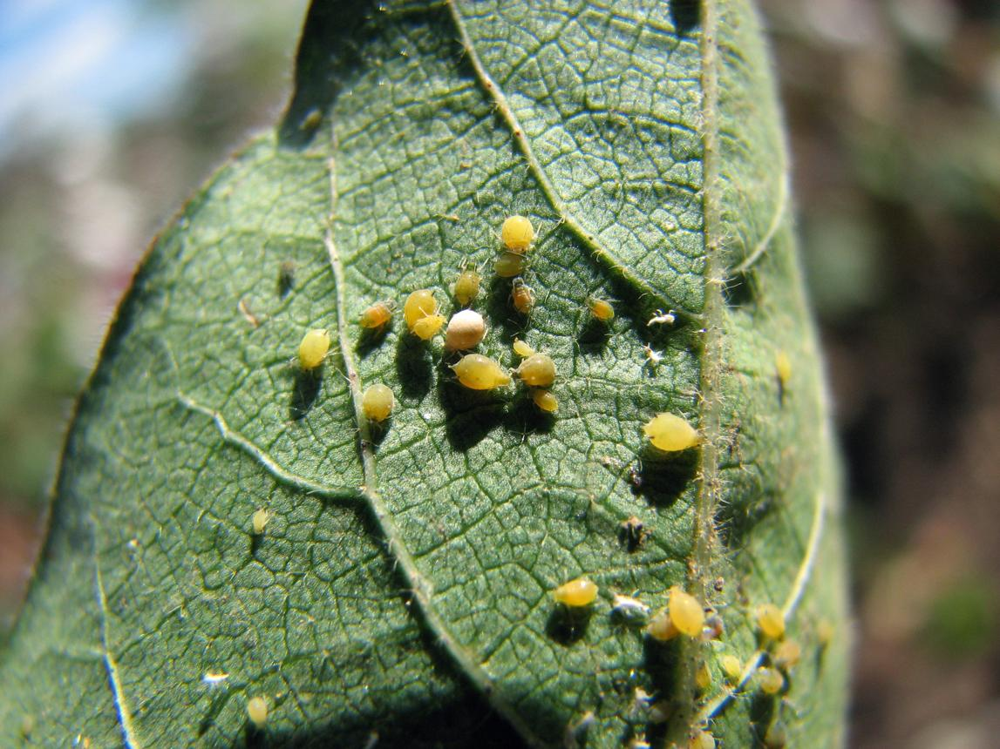
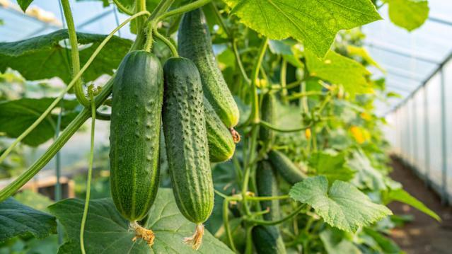
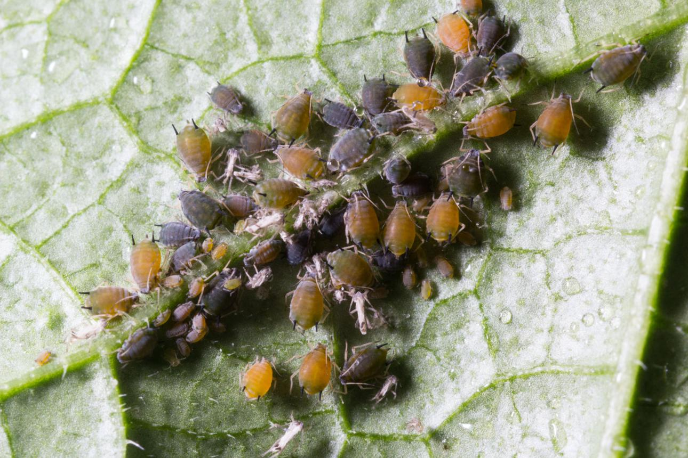
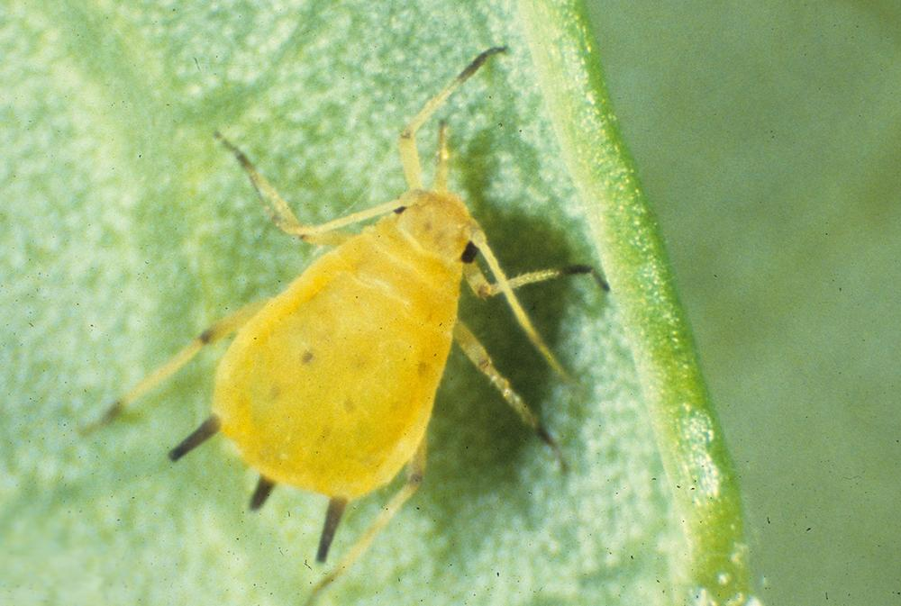

## 1. Introduction

Cucumber (Cucumis sativus) is a vegetable crop belonging to the Cucurbitaceae family. It is widely consumed in the United Kingdom in salads, sandwiches and other fresh foods.

The Royal Horticultural Society (RHS) explains that cucumbers are warm-season plants that can be grown in greenhouses, polytunnels or suitable outdoor locations. They require warmth, regular watering and appropriate growing conditions to produce healthy fruit.

One pest that can affect cucumber plants is the cotton or melon aphid (Aphis gossypii). This small insect feeds on plant sap, potentially causing leaf distortion, reduced growth and the transmission of plant viruses.

This report examines cucumber cultivation and its importance in the UK, focusing specifically on the identification, symptoms and prevention of Aphis gossypii. The findings will support the cucumber pest information section of the Pest 2 Veg website.

## 2. Importance of cucumber in the United Kingdom

[tecnologiahorticola.com](https://www.tecnologiahorticola.com/es/semillas-fito/semillas-fito-completa-su-oferta-de-pepino-holandes?utm_source=chatgpt.com)

Cucumbers are important in the UK because they contribute to healthy eating, horticultural production and the availability of fresh vegetables.

Nutritional importance: Cucumbers contain a high proportion of water and provide small quantities of vitamins, minerals and dietary fibre. They are commonly eaten fresh.

Economic importance: Cucumber cultivation supports commercial horticultural businesses, including greenhouse growers, suppliers and food distributors. Locally produced cucumbers can contribute to the UK vegetable supply during the growing season.

Agricultural importance: The RHS explains that cucumbers can grow successfully in protected environments and warm outdoor locations. Greenhouse varieties generally have a longer cropping season than outdoor varieties. Vertical growing also helps make efficient use of limited space.

## 4. Name and identification of pest

Common name: Cotton aphid or melon aphid

Scientific name: Aphis gossypii

Pest category: Sap-sucking insect

Affected crop: Cucumber (Cucumis sativus)

Source image: [Wikimedia Commons – Aphis gossypii](https://commons.wikimedia.org/wiki/File:Aphis_gossypii_252211094.jpg?utm_source=chatgpt.com)

Aphis gossypii is a small, soft-bodied insect that can appear yellow, green or dark green. Aphids commonly feed in groups on young shoots and the undersides of leaves.

They extract sap using specialised mouthparts. Large colonies can weaken cucumber plants and interfere with healthy growth. Some aphids can also spread plant viruses.

The Wikimedia Commons photograph you selected is identified as Aphis gossypii and is available under the Creative Commons Attribution 4.0 licence, which permits reuse with appropriate credit.

Wikimedia Commons

## 5. Symptoms of aphid infestation

| **Symptom**     | **Description**                                                       |
| --------------- | --------------------------------------------------------------------- |
| Leaf curling    | Young cucumber leaves may curl or become distorted.                   |
| Yellowing       | Leaves may turn pale or yellow, particularly under heavy infestation. |
| Stunted growth  | Severe feeding may reduce plant vigour and growth.                    |
| Sticky honeydew | Aphids produce a sugary substance that accumulates on leaves.         |
| Sooty mould     | Dark fungal growth may develop on honeydew-covered surfaces.          |
| Visible insects | Clusters of aphids may be seen beneath leaves or around growing tips. |

The RHS confirms that aphids can cause distorted growth and produce honeydew, which may lead to sooty mould.

RHS Advice

Additional risk: Some aphids transmit cucumber mosaic virus, which may cause yellow mottling, distorted leaves and reduced growth. Virus infection should be distinguished from direct aphid feeding damage.

## 6. Prevention and control of aphids

Preventing serious aphid infestations requires early detection and appropriate crop management.

  - Regular monitoring: Inspect cucumber leaves, especially their undersides, for developing colonies.

  - Biological control: Encourage beneficial insects such as ladybirds, lacewings and hoverflies that naturally feed on aphids.

  - Physical removal: Small colonies can sometimes be removed by hand or washed off carefully with water.

  - Greenhouse hygiene: Check newly introduced plants and control weeds that may harbour aphids.

  - Balanced feeding: Avoid excessive nitrogen fertilisation that encourages soft, vulnerable plant growth.

  - Integrated pest management: Prioritise monitoring, biological controls and suitable non-chemical approaches before considering authorised pesticides.

These measures are consistent with the RHS approach to managing aphids while protecting beneficial wildlife.

RHS Advice

## 7. Pictures and image permissions

For your final research, use the following two photographic subjects:

Figure 1. Cucumber crop

Illustrative image. Use the RHS as a research reference, but obtain a separately licensed photograph for publication.

Figure 2. Melon aphids

Illustrative image. Use the specific Wikimedia Commons file linked below for documented reuse permission.

Approved image reference for Figure 2:

Abair, A. (2023) Aphis gossypii 252211094.jpg \[Photograph\]. Wikimedia Commons. Available at: [Original photograph](https://commons.wikimedia.org/wiki/File:Aphis_gossypii_252211094.jpg?utm_source=chatgpt.com). Licensed under [CC BY 4.0](https://creativecommons.org/licenses/by/4.0/?utm_source=chatgpt.com).

This licence permits reuse and modification with attribution. Include the photographer, source, licence link and any changes made. Do not label the leaf as cucumber unless its host plant has been verified.

.

## 10. References (Harvard style)

Royal Horticultural Society (n.d.) How to grow cucumbers. Available at: [RHS cucumber growing guide](https://www.rhs.org.uk/vegetables/cucumbers/grow-your-own?utm_source=chatgpt.com) (Accessed: 16 October 2026).

Royal Horticultural Society (n.d.) Aphids. Available at: [RHS aphid guidance](https://www.rhs.org.uk/biodiversity/aphids?utm_source=chatgpt.com) (Accessed: 16 October 2026).

Abair, A. (2023) Aphis gossypii 252211094.jpg \[Photograph\]. Wikimedia Commons. Available at: [Wikimedia Commons](https://commons.wikimedia.org/wiki/File:Aphis_gossypii_252211094.jpg?utm_source=chatgpt.com) (Accessed: 16 October 2026).

1\. Royal Horticultural Society (RHS) – Cucumber Research

[https://www.rhs.org.uk/vegetables/cucumbers/grow-your-own](https://www.rhs.org.uk/vegetables/cucumbers/grow-your-own?utm_source=chatgpt.com)

Covers cucumber cultivation in the UK, growing conditions, planting, harvesting and common problems.

RHS Guide

2\. Royal Horticultural Society (RHS) – Aphid Research

[https://www.rhs.org.uk/biodiversity/aphids](https://www.rhs.org.uk/biodiversity/aphids?utm_source=chatgpt.com)

Explains aphid identification, symptoms, plant damage and prevention methods.

RHS Advice

3\. Wikimedia Commons – Aphid Photograph

[https://commons.wikimedia.org/wiki/File:Aphis\_gossypii\_252211094.jpg](https://commons.wikimedia.org/wiki/File:Aphis_gossypii_252211094.jpg?utm_source=chatgpt.com)

Cotton or melon aphid (Aphis gossypii)
