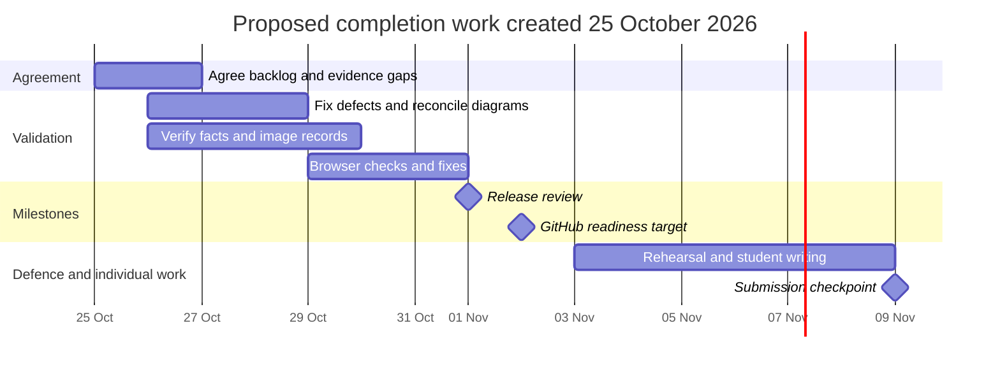

# Proposed completion schedule

Created 25 October 2026. This is a new proposal for team agreement, not evidence of historical sprint commitments. No task is represented as completed merely because its planned date has passed. Confirm owners, capacity and Moodle dates at an actual planning meeting.

| Dates | Goal | Suggested roles | Completion evidence |
|---|---|---|---|
| 25-26 Oct | Agree backlog, confirm roles, locate existing evidence | Scrum Master and all members | Actual decisions and accepted owners; original records linked |
| 26-28 Oct | Resolve BUG-01 to BUG-04; reconcile diagram scope | Logic, frontend, UI/UX | Regression checks and peer review; readable diagrams |
| 26-29 Oct | Verify sources, workbook and image credits | Research and asset owner | Per-record review; precise links; resolved permission gaps |
| 29-31 Oct | Browser, accessibility and usability checks; fix findings | QA and all members | Completed manual checklist and real feedback |
| 1 Nov | Review release candidate and record sprint review | Team | Test report, defect decisions, actual acceptance record |
| 2 Nov | GitHub construction readiness milestone | Integration | Verified reviewed remote snapshot; confirm deadline with Moodle |
| 3-8 Nov | Rehearse viva; refine individual article and portfolio | All members individually/as group | Real rehearsal notes; student-authored assessed work |
| 9 Nov | Assessment submission checkpoint | Each student / group as required | Moodle receipt; confirm exact deliverables and viva date |

Milestones are targets, not achieved events. The brief gives 9 November; slides specify earlier GitHub construction readiness on 2 November. Confirm the current submission/viva schedule rather than resolving the conflict by assumption. Weekly portfolio submissions follow the brief's Mondays of Weeks 2-5; exact dates require Moodle confirmation.

If the team adopts a short completion sprint, record its actual start, agreed goal, members, capacity, chosen backlog and review date at planning. Update progress from evidence; do not backfill daily activity from this Gantt.
